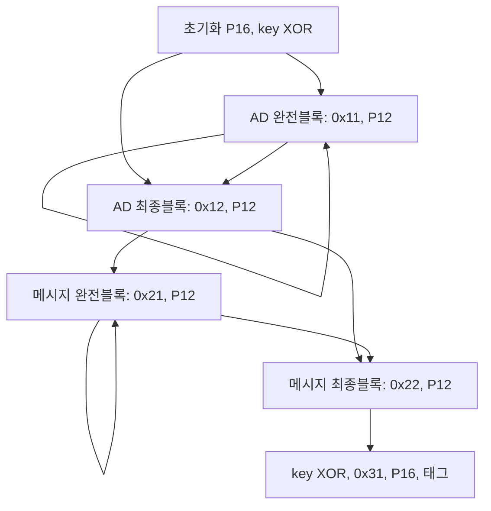

# CrossWeave 규범 명세

이 문서는 현재 연구 설계 하나를 정의한다. 기능 구현과 보안 검증의 진행
상태는 별도로 기록한다. 설계 변경 시 코어·독립 벡터·공격 회귀를 함께 갱신한다.

## 목표와 상태

공개 순열은 키 없는 384비트 전단사 함수다. 공격자는 전체 상태의 정방향과
역방향을 질의할 수 있다. 역함수 계산 자체는 공격이 아니다. 차분·선형·적분·
대칭 구별자와 불변 부분공간을 찾아 정확한 라운드 범위와 비용을 계량한다.

상태는 little-endian 64비트 레인 6개다. AEAD에서만 앞 16바이트를
rate(128비트), 뒤 32바이트를 capacity(256비트)로 구분한다. 키·Nonce·태그는
각각 128비트다. capacity 크기만으로 256비트 키 탐색 강도를 주장하지 않는다.

P12는 라운드 0~11, P16은 0~15를 사용한다.
`P16=R15 o R14 o R13 o R12 o P12`라는 공개 관계가 있으므로 두 호출을
독립 무작위 순열로 모델링하지 않는다.

AEAD 목표는 고유 Nonce 조건의 IND-CPA와 INT-CTXT다. 공격자는 공개
Nonce·AD·평문을 선택하고 복호화의 성공·실패를 관찰할 수 있다. 관련 키,
Nonce 오용, 물리적 부채널과 fault는 이 목표 모델에 포함하지 않는다.
현재 목표에 대한 보안 증명이나 공격 비용 하한은 없다.

## 입력 크기와 실패 계약

키·Nonce·태그는 각각 정확히 16바이트다. 태그 절단을 허용하지 않는다.
메시지와 AD는 각각 `2^24`바이트 이하로 제한한다. 이는 자원 제한이며
키당 안전한 총 데이터량을 증명하지 않는다. 키당 총 블록·질의·위조 시도
한계는 별도로 분석해야 한다.

반환값은 OK=0, INPUT=-1, AUTH=-2, MEMORY=-3이다. 고정 길이 포인터는
NULL을 허용하지 않으며 가변 입력은 길이 0일 때만 NULL을 허용한다.
길이·포인터·오버랩 오류는 INPUT이며 호출자는 버퍼의 실제 용량을 보장한다.
C 함수는 포인터만으로 유효 용량을 자동 확인할 수 없다.

AEAD는 분리된 태그를 사용하며 성공 때만 사용자 출력에 쓴다. 모든 오류에서
기존 출력은 보존한다. 복호화는 임시 평문에서 태그를 검증하고 성공 후에만
출력에 복사하며 임시 비밀을 소거해야 한다. 가변 길이 함수와 in-place 허용
범위는 AEAD 구현 때 확정한다. 현재 헤더는 크기와 오류 코드만 제공한다.

## AEAD 상태 전이

`IV=SHAKE256(ASCII("CrossWeave/IV"),16)`이다. 초기화는
`S=P16(nonce||key||IV)` 다음 `S[16:32] ^= key`다. 인덱스는 0부터 센다.
모든 단계 마커는 `S[47]`에 XOR한다.

| 단계 | rate 갱신 | 마커 | 후속 |
|---|---|---|---|
| AD 완전블록 | AD 16바이트 XOR | `0x11` | P12 |
| AD 최종블록 | tail XOR, `S[t] ^= 0x80` | `0x12` | P12 |
| 메시지 완전블록 | `C=P XOR S[0:16]`, `S[0:16]=C` | `0x21` | P12 |
| 메시지 최종블록 | tail t바이트 암호화·덮어쓰기, `S[t] ^= 0x80` | `0x22` | P12 |
| 최종화 | `S[16:32] ^= key` | `0x31` | P16, `tag=S[0:16] XOR key` |

각 단계는 `floor(length/16)`개 완전블록 뒤에 **항상 하나의 최종블록**을
처리한다. 빈 값과 정확한 16바이트 배수도 t=0의 빈 최종블록을 추가한다.
tail 길이는 `0<=t<16`이다. 메시지 tail 밖의 rate 바이트는 보존하며,
평문 tail 암호화 뒤 패딩을 XOR한다. 패딩은 암호문으로 출력하지 않는다.



프레이밍의 최종 padded block은 `tail||0x80||0^(15-t)`다. 오른쪽의 0들을
제거한 뒤 마지막 `0x80`을 제거하면 tail이 유일하게 복구된다. 완전블록의
개수와 서로 다른 단계 마커까지 포함한 전이열은 원래 단계·입력으로 복구된다.
이는 프레이밍 인코딩의 단사성 논증이며 유한한 내부 상태의 충돌 부재나
AEAD 보안성 증명이 아니다. 메시지 전이의 실제 입력은 암호문 덮어쓰기이며,
평문과의 대응은 해당 rate 상태가 주어진 경우에만 일대일이다.

## P384 비트 명세

LE 64비트 레인 `a[0..5]`의 덧셈은 `mod 2^64`이고 모든 결과는 64비트다.
회전은 64비트 왼쪽 회전이며, 라운드는 다음과 같다.

```
f(x,y,r,i) = ROL64(x,(7*i+3*r)%63+1)
           XOR ROL64(y,(13*i+5*r)%63+1)
           XOR (x AND ROL64(y,11)) XOR (x+y mod 2^64)
for r = first .. first+count-1:
    for i in (0,2,4): a[i] ^= f(a[(i+1)%6],a[(i+5)%6],r,i)
    for i in (1,3,5): a[i] ^= f(a[(i+1)%6],a[(i+5)%6],r,i)
    a[0] ^= RC[r][0]; a[3] ^= RC[r][3]
    out[i] = ROL64(a[PERM[i]],ROT[i])  # i=0..5, 동시 대입
    a = out
```

`PERM=(2,5,1,4,0,3)`, `ROT=(1,7,19,31,43,57)`이다. 짝수 단계는 이전
홀수 레인, 홀수 단계는 갱신된 짝수 레인을 읽는다. 재배열은 임시 배열로
동시에 수행한다. 반단계 안에서는 상대 parity만 읽으므로 순서 의존성이 없다.

첨부 수식에는 XOR 대상 i에 대한 f의 입력 레인 인덱스가 빠져 있었다.
**앞뒤 이웃 `(i+1)%6`, `(i+5)%6` 순서**를 이번 규범 명세에서 보완했다.
이 값은 인계 문서의 원래 값이 아니라 추가한 설계 결정이다. 자기 레인을
f에서 읽지 않으므로 같은 XOR 갱신을 다시 적용하면 복구된다. 모든 새 벡터는
이 결정을 반영하며 과거 설계의 벡터를 재사용하지 않는다.

상수는 r=0..15, j=0 또는 3에 대해
`RC[r][j]=LE64(SHAKE256(ASCII("cw-p384/round-"+decimal(r)+"/lane-"+decimal(j)),8))`다.
각 도메인을 개별 해시하며 십진수에 선행 0·공백·개행·NUL이 없다.
XOF 길이 8은 바이트 단위다. IV 도메인의 출력은 16바이트다.

역라운드는 `a[PERM[i]]=ROR64(out[i],ROT[i])`, 상수 XOR, 홀수 5/3/1,
짝수 4/2/0 갱신 순서다. 역순열은 마지막 라운드부터 처음으로 돌아간다.
반단계 XOR는 스스로의 역함수이고 상수 XOR·재배열·회전은 전단사이므로
합성 순열도 전단사다. 전단사성은 암호학적 보안성의 증명이 아니다.

## 공개 순열 인터페이스

`crossweave_permute(state,first_round,round_count)`와 inverse는 접근 가능한
48바이트를 제자리 갱신한다. 정렬 제약·외부 상태·할당은 없다.
`first_round<=16`, `round_count<=16-first_round`가 유효하다. 0라운드는
항등이며 `(16,0)`도 허용하나 NULL은 항상 INPUT 오류다. 범위 검사는 덧셈
전에 수행한다. 오류에서는 state를 보존하며 성공은 OK다.
역함수도 정방향과 같은 첫 라운드 번호를 받는다. P12/P16 및 각각의 inverse는
`(0,12)/(0,16)`의 편의 함수다. 헤더 선언 후 전체 라운드 조합 단계에서 연결한다.
